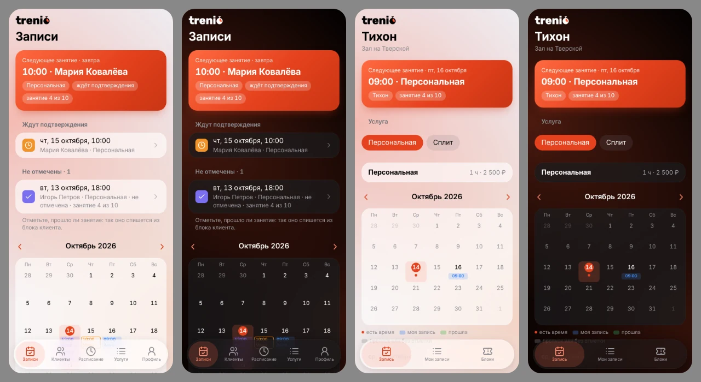
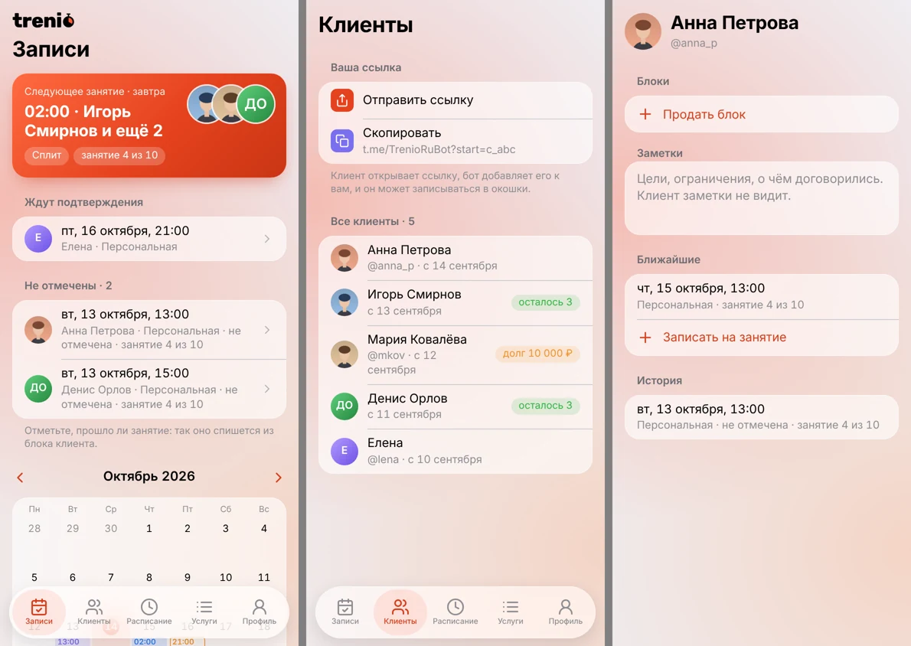
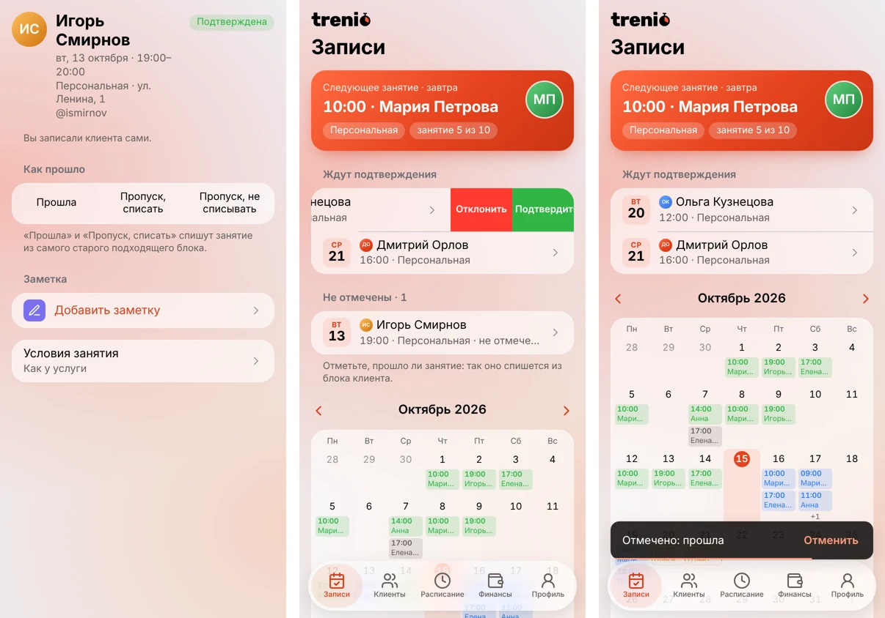
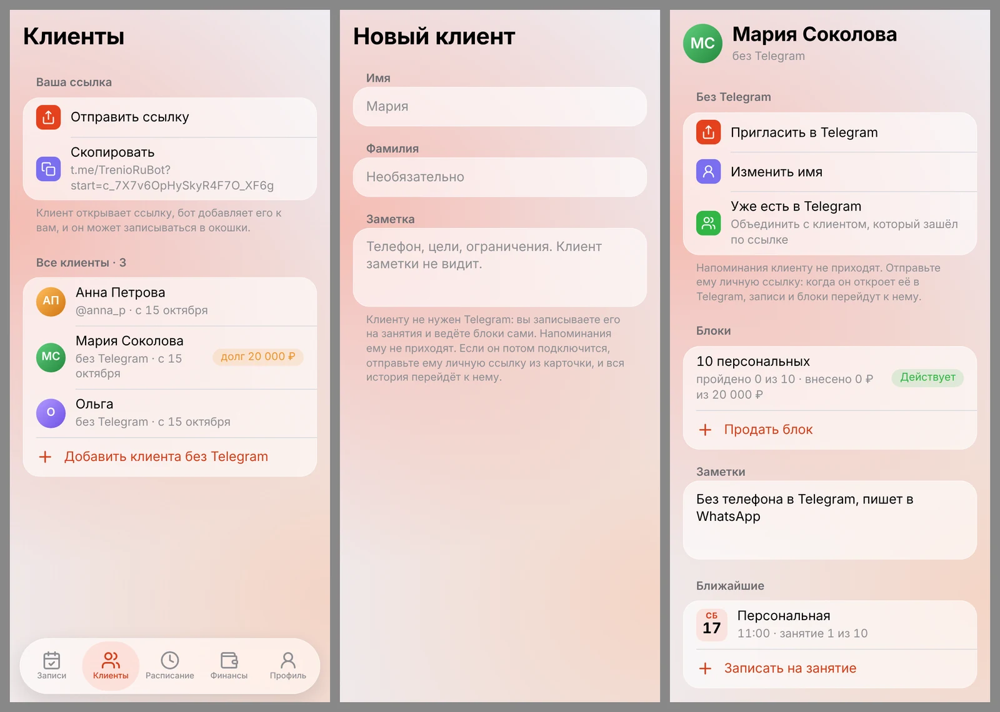
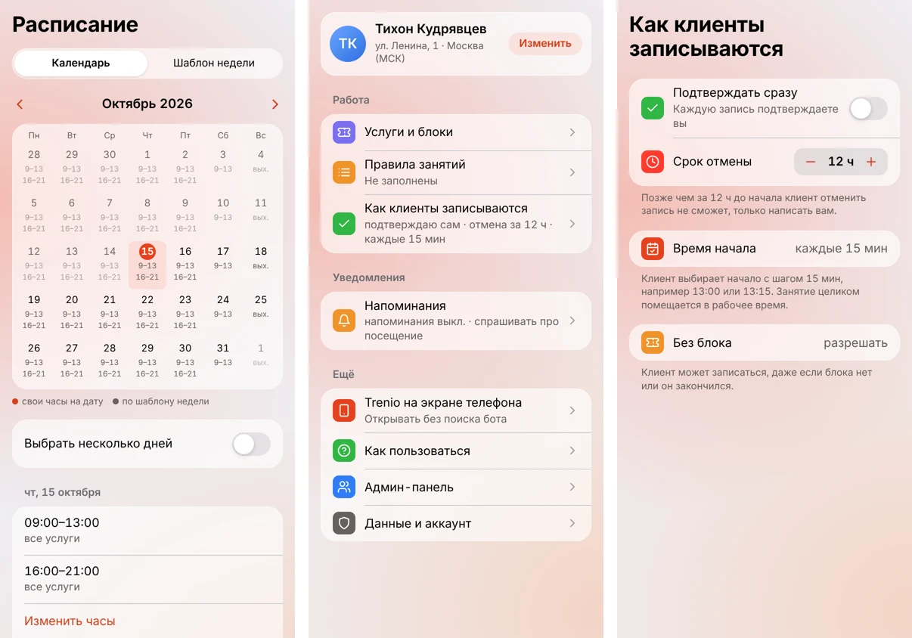
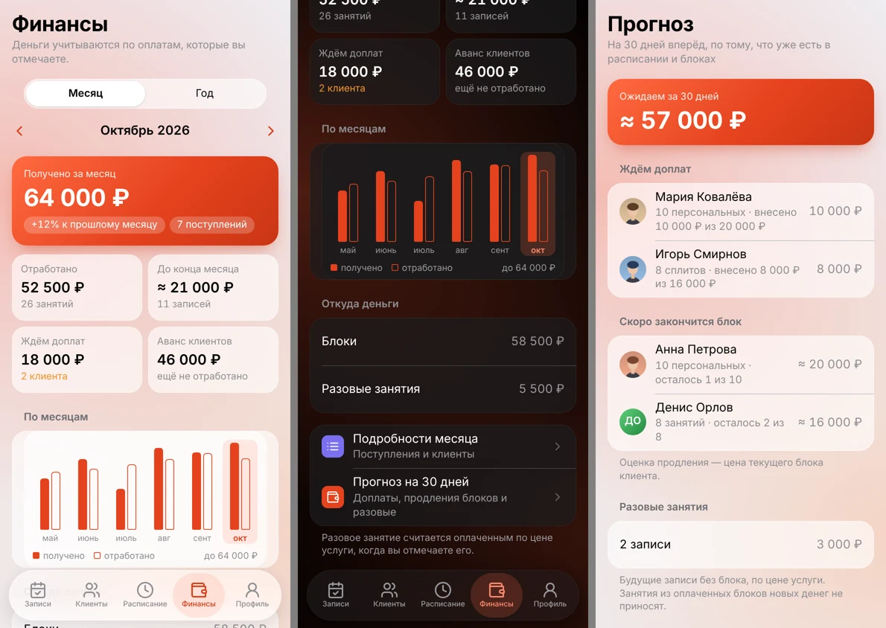
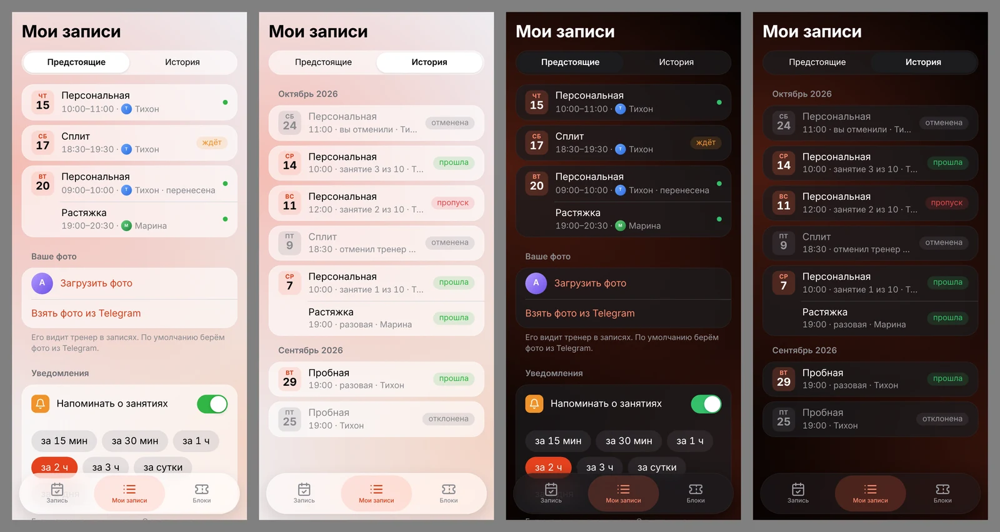
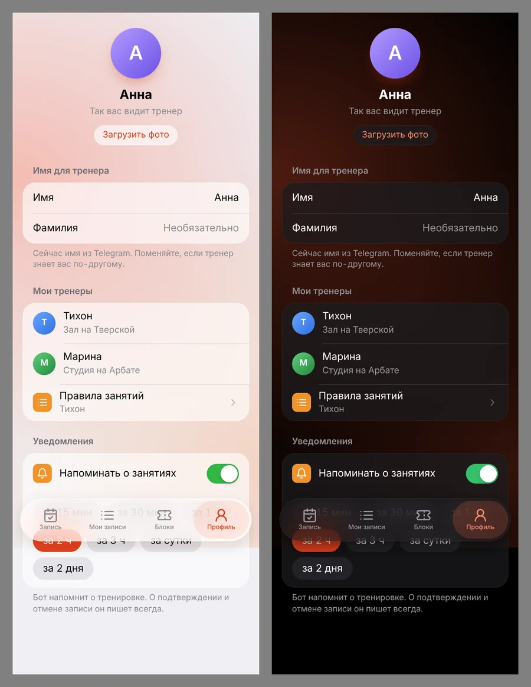
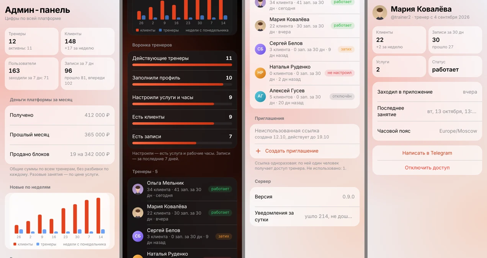

<p align="center">
  <picture>
    <source media="(prefers-color-scheme: dark)" srcset="assets/brand/trenio-wordmark-white.svg">
    
  </picture>
</p>

<p align="center">
  <b>Запись к фитнес-тренеру без переписки.</b><br>
  Telegram-бот и Mini App: тренер ведёт расписание, клиентов, блоки занятий и деньги,
  а клиенты сами записываются в свободные окошки.
</p>

<p align="center">
  <a href="https://t.me/TrenioRuBot">@TrenioRuBot</a> ·
  <a href="CHANGELOG.md">Что нового</a> ·
  <a href="docs/brand-guidelines.md">Фирменный стиль</a>
</p>



## Зачем это

Обычно запись к тренеру живёт в переписке: «а завтра в семь можно?», «я перенесу на четверг»,
«сколько у меня осталось занятий?». Trenio забирает это на себя:

- тренер один раз задаёт рабочие часы и услуги, из них получаются окошки;
- клиент открывает ссылку тренера в Telegram и записывается сам, без звонков и сообщений;
- бот напоминает о занятиях обоим и спрашивает тренера, прошло ли занятие;
- блоки занятий («10 тренировок за 20 000 ₽») считаются сами: сколько пройдено, сколько оплачено, кто должен.

Сейчас Trenio в закрытой бете: доступ тренера выдаёт админ, для клиентов приложение бесплатно.
Оплат внутри приложения нет, Trenio только учитывает деньги, которые тренер отмечает.

## Для тренера

Вкладки: **Записи**, **Клиенты**, **Расписание**, **Финансы**, **Профиль**.



**Записи.** Сверху карточка ближайшего занятия, ниже заявки, которые ждут подтверждения,
и прошедшие занятия, которые ещё не отмечены. Под ними календарь месяца со всеми записями.
Тренер может записать клиента сам и в любое время, даже вне окошек: Trenio проверит только,
что у тренера нет другого занятия. Запись можно перенести или отменить с комментарием,
клиент увидит причину.

**Клиенты.** Поиск по имени и фильтры: у кого кончается блок, кто должен, у кого записи
без блока. Под именем видно, сколько занятий блока пройдено. Кнопка «＋ Пригласить» открывает
личную ссылку для клиентов (отправить в Telegram или скопировать): клиент открывает её,
бот добавляет его к тренеру, и он может записываться.

**Карточка клиента.** Сверху четыре кнопки: записать, продать блок, написать в Telegram
и телефон. Ниже действующий блок с полоской прогресса, заметки (клиент их не видит),
ближайшие занятия и три последних прошедших, остальное в «Вся история». На второй вкладке
прогресс клиента: замеры с графиками.



**Действия с записью.** В деталях записи сверху сводка: клиент, время, услуга, место,
статус. После занятия три кнопки: «Прошла», «Пропуск, списать», «Пропуск, не списывать».
То же быстрее делается свайпом влево по строке записи: у прошедшей «Пропуск» и «Пришёл»
(полный свайп сразу отмечает «Пришёл»), у заявки «Отклонить» и «Подтвердить», у будущей
«Перенести» и «Отменить».

**«Отменить» вместо «Вы уверены?».** Отметка посещения, удаление заметки, телефона,
замера, оплаты или рабочих часов срабатывает сразу, а внизу 5 секунд висит плашка
«Отменить». Подтверждение спрашивается только там, где ошибку не вернуть: удаление
аккаунта, блока с оплатами, объединение клиентов.



**Клиенты без Telegram.** Не все клиенты готовы ставить бота. Тренер заводит такого клиента сам
по имени, записывает его на занятия и ведёт его блоки как обычно, только напоминания ему не
приходят. Если клиент потом всё же подключится, тренер отправляет ему личную ссылку из
карточки: когда он откроет её в Telegram, вся история, записи и блоки перейдут к нему.
Если клиент уже успел зайти по общей ссылке, две карточки можно объединить.



**Расписание.** Шаблон рабочей недели и календарь месяца, где на любую дату можно задать
свои часы или выходной. Несколько дней правятся разом, неделю можно повторить на следующие.
Из этих часов и длительности услуг получаются окошки для клиентов.

**Услуги и правила.** У каждой услуги своё название, длительность, цена, вместимость
(индивидуальная или сплит на несколько человек) и при желании своё место. Выключенная услуга
пропадает из окошек, но остаётся в истории. Там же шаблоны блоков и правила занятий:
клиент принимает их перед первой записью.

**Профиль.** Сверху имя, фото и адрес с кнопкой «Изменить». Ниже три группы.
«Работа»: услуги и блоки, правила занятий и экран «Как клиенты записываются»
(подтверждать ли записи сразу, срок отмены, шаг времени начала, можно ли записываться без блока).
«Уведомления»: напоминания. «Ещё»: «Trenio на экране телефона», повтор вводного тура,
админ-панель и данные аккаунта.

### Блоки и посещения

Блок — несколько занятий по одной цене, например 10 персональных за 20 000 ₽ на 60 дней.
Тренер продаёт блок в карточке клиента, отмечает оплаты частями, и Trenio показывает
«пройдено 3 из 10, внесено 10 000 ₽ из 20 000 ₽».

Занятие никогда не списывается автоматически. После тренировки тренер выбирает
одно из трёх: «прошла», «пропуск, списать» или «пропуск, не списывать». Если у клиента
несколько активных блоков, списывается самый старый подходящий. Запись без блока считается
разовой и оплачивается по цене услуги. Когда в блоке остаётся два занятия, одно или ни одного,
бот предупреждает и тренера, и клиента.

### Финансы



- **Получено** — сколько денег пришло за месяц по отмеченным оплатам, с ростом к прошлому месяцу.
- **Отработано** — сколько стоили проведённые занятия: цена блока делится на его занятия,
  разовые идут по цене услуги.
- **Ждём доплат** и **аванс клиентов** — кто должен и сколько оплачено вперёд.
- График по месяцам, разбивка на блоки и разовые, подробности месяца и итоги года.
- **Прогноз на 30 дней** — новые деньги из доплат, продлений блоков и будущих разовых занятий.

## Для клиента

Вкладки: **Запись**, **Мои занятия**, **Профиль**.

**Запись.** Ближайшее занятие и список своих тренеров (у клиента их может быть несколько).
Клиент выбирает тренера и услугу, видит календарь со свободными днями и записывается
в окошко. Если тренер подтверждает записи вручную, запись ждёт его ответа. Карточка
«Как в прошлый раз» предлагает ближайшее свободное окошко с той же услугой, днём недели
и временем, что в последней записи, и записывает одним нажатием.



**Мои занятия.** Ближайшее занятие, действующие блоки с полоской (сколько пройдено и оплачено)
и три вкладки. «Предстоящие» по дням: запись можно перенести или отменить с комментарием,
пока не вышел срок отмены тренера. «История» по месяцам: что прошло, что пропущено, что
отменено и кем, ниже прошлые блоки. «Прогресс» — замеры, которые записал тренер.

<p align="center">
  
</p>

**Профиль.** Фото (по умолчанию из Telegram, можно заменить или убрать), имя для тренера,
список тренеров с их правилами и настройки напоминаний: за 15 минут, за час, за сутки
и так далее, можно выбрать несколько.

## Бот

Бот — вход в приложение и канал уведомлений. Команда `/start` открывает Mini App,
а ссылка тренера с параметром привязывает клиента к нему.

Что приходит в Telegram:

- тренеру: новая запись, отмена клиентом, перенос, напоминание о занятии,
  вопрос «прошло ли занятие» с кнопками ответа прямо под сообщением;
- клиенту: подтверждение или отказ тренера, запись от тренера, отмена, перенос, напоминания;
- обоим: в блоке осталось два занятия, одно или блок закончился.

Под уведомлениями есть кнопки: тренер подтверждает или отклоняет заявку и отмечает
«прошла» или «пропуск», клиент может отменить запись. Многое делается, не открывая приложение.
Кнопка «Открыть заявку», «Открыть запись» или «Открыть клиента» открывает Mini App сразу
на нужном экране. Если запись уже отменили, приложение скажет об этом плашкой.
Напоминание приходит ровно один раз, даже если сервер перезапустился.

## Для админа



Админ-панель открывается из профиля. В ней общие цифры платформы: тренеры, клиенты,
активность за неделю, записи, обороты всех тренеров вместе (без разбивки по каждому),
рост по неделям и воронка тренеров от «заполнил профиль» до «есть записи». Там же список
тренеров со статусом (работает, затих, не настроил, отключён), одноразовые приглашения
для новых тренеров и состояние сервера.

В боте те же действия доступны командами: `/invite` (ссылка-приглашение тренера),
`/trainers` (список), `/revoke` и `/restore` (отключить и вернуть доступ).

## Удобство

- **Вводный тур.** При первом входе тренер и клиент видят короткий тур по вкладкам,
  повторить его можно из Профиля.
- **Быстрые вкладки.** Данные вкладок кэшируются, переключение мгновенное, а свежие данные
  подгружаются в фоне. Список обновляется жестом вниз и сам, когда возвращаешься в приложение.
- **Без связи.** Если сервер недоступен, сверху появляется плашка «Нет связи с сервером»
  с кнопкой «Повторить», а на экране остаётся то, что успело загрузиться.
- **Ошибки.** Если что-то сломалось, вместо белого экрана показывается экран ошибки
  с кнопкой перезапуска, а отчёт об ошибке приходит админу в Telegram.
- **Значок на телефоне.** Trenio можно добавить на экран телефона. На третий день тренер
  один раз видит подсказку об этом, если Telegram это поддерживает.

## Внешний вид

Дизайн «Стекло везде»: тёплый фон со свечением, полупрозрачные карточки и плавающая панель
вкладок. Приложение подстраивается под светлую и тёмную тему Telegram. Фирменный цвет —
коралл, логотип — секундомер вместо буквы «о» в слове trenio. Файлы логотипа лежат
в [`assets/brand/`](assets/brand/), правила в [docs/brand-guidelines.md](docs/brand-guidelines.md).

## Как устроено

```text
Telegram ──► бот (aiogram, webhook) ─┐
                                      ├─► сервисный слой ─► PostgreSQL
Mini App (React) ──► HTTP API ───────┘          ▲
                     (FastAPI, JWT)              │
                     планировщик ── очередь уведомлений
```

| Часть | Технологии |
| --- | --- |
| Backend | Python 3.12, FastAPI, aiogram 3, SQLAlchemy 2 (async), Alembic, APScheduler |
| Mini App | React 19, TypeScript, Vite |
| База | PostgreSQL |
| Инфраструктура | Docker Compose, nginx, GitHub Actions, ghcr.io, release-please |

Несколько решений, которые стоит знать:

- **Вся логика в сервисном слое API.** Бот и Mini App ходят в одни и те же сервисы, поэтому
  позже можно сделать мобильное приложение, не переписывая backend.
- **Свой вход по JWT.** Mini App присылает подписанную Telegram `initData`, backend проверяет
  подпись и выдаёт свой токен. Telegram — лишь один из способов входа.
- **Уведомления через очередь.** События и напоминания кладутся в таблицу `notifications`,
  планировщик раз в минуту забирает их с `FOR UPDATE SKIP LOCKED`, поэтому ничего
  не отправляется дважды. Канал доставки абстрагирован, рядом с Telegram можно добавить push.
- **Время в часовом поясе тренера.** Окошки и напоминания считаются по нему.

### Структура репозитория

| Папка | Что внутри |
| --- | --- |
| `backend/` | Пакет `trenio`: API, бот, планировщик, модели и миграции, тесты |
| `frontend/` | Mini App: экраны тренера (`trainer/`), клиента (`client/`), админа (`admin/`), общий UI (`ui/`) |
| `deploy/` | Скрипты деплоя, бэкапа и проверки восстановления, общий PostgreSQL, таймеры systemd |
| `assets/brand/` | Логотип, аватарка и картинка бота |
| `docs/` | Фирменный стиль и картинки для README |

### Роли backend

Один пакет `trenio`, одна команда с разными ролями:

| Команда | Что запускает |
| --- | --- |
| `python -m trenio all` | API, бот и планировщик в одном процессе (компактная схема на сервере) |
| `python -m trenio api` | только HTTP API |
| `python -m trenio bot` | только бот |
| `python -m trenio scheduler` | только планировщик |
| `python -m trenio migrate` | применить миграции базы |

Все настройки приходят из переменных окружения, список в [`.env.example`](.env.example).
`GET /health` отвечает, жив ли сервис, доступна ли база и не застряла ли очередь уведомлений.

## Разработка

Docker на ноутбуке не нужен: код проверяется в CI, а запускается на сервере.

```bash
cd backend
python -m venv .venv && source .venv/bin/activate
pip install -e ".[dev]"
ruff check . && ruff format --check . && mypy src tests && pytest
```

Тесты API и миграций идут, только если задан `TEST_DATABASE_URL`
(в CI его даёт контейнер PostgreSQL), иначе они пропускаются.

Новая миграция после изменения моделей:

```bash
alembic revision --autogenerate -m "что изменилось"
```

Mini App: см. [`frontend/README.md`](frontend/README.md).

## Релизы и окружения

- Работа идёт в `main` через pull request с зелёным CI, коммиты в формате Conventional Commits.
- CI собирает образы `trenio-backend` и `trenio-web` и кладёт их в ghcr.io.
- Каждый мердж в `main` сам выкатывается на dev.
- release-please ведёт версию по SemVer и [CHANGELOG](CHANGELOG.md). Релиз `vX.Y.Z` выкатывается
  на prod после подтверждения, перед этим делается бэкап базы, после проверяется `/health`.
- База бэкапится каждый день, копия уходит в Telegram; для проверки восстановления есть `deploy/restore-check.sh`.
